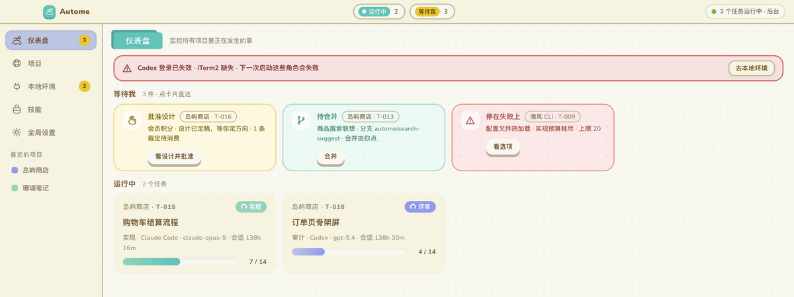
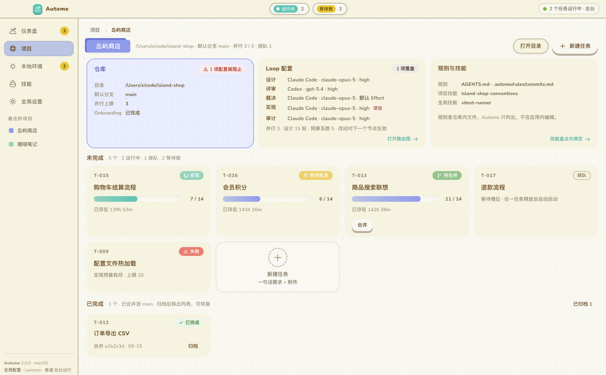
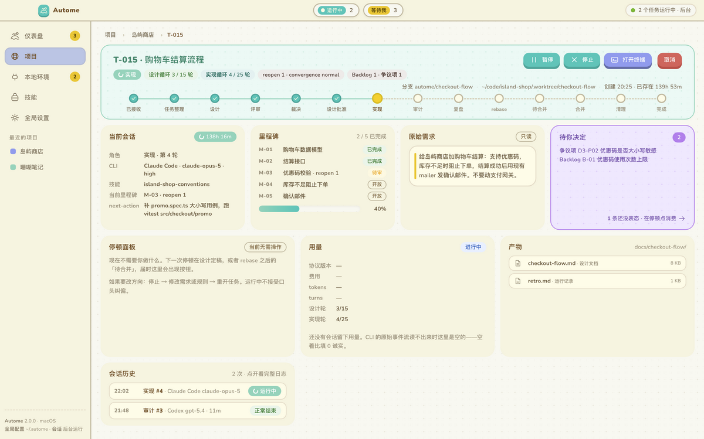
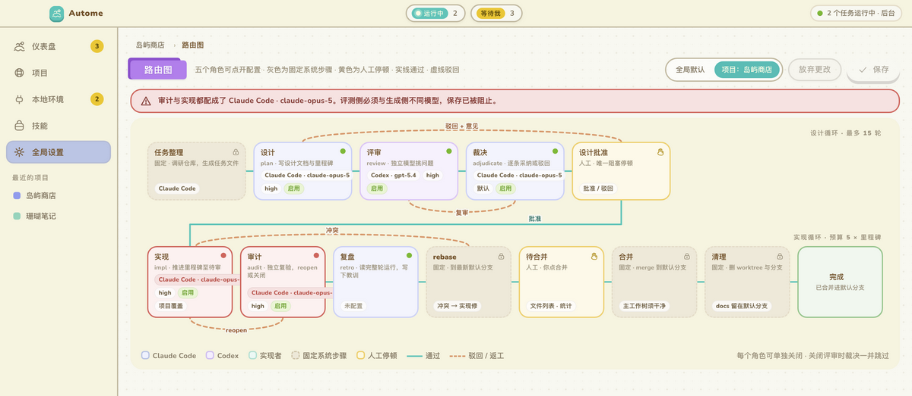
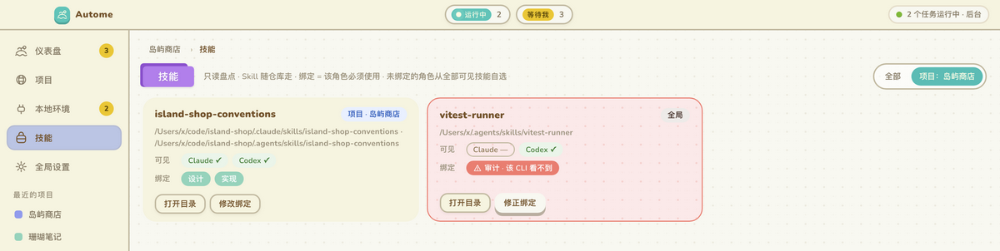
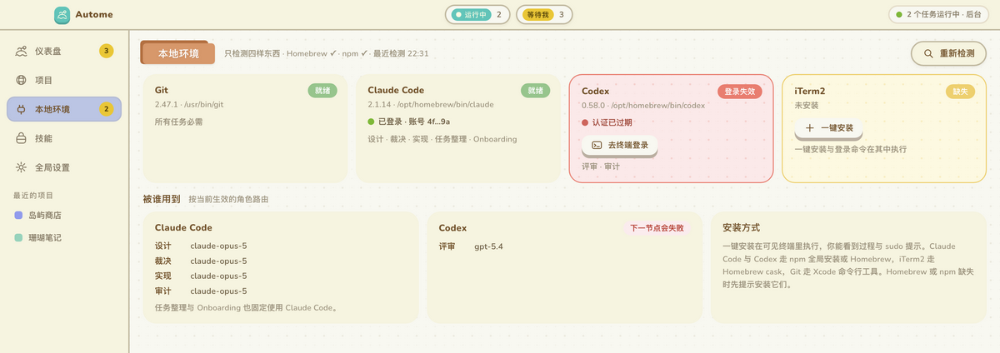

# Autome 2.0

A macOS desktop app that turns a one-line request into a merged branch.

You point it at a Git repository and type what you want. It runs Claude Code
and Codex through a Loop of six roles — design, review, adjudicate, implement,
audit, retro — in a dedicated worktree, and stops for you exactly twice: once
to approve the design, once to press merge.

## What it looks like

Every screenshot below is the real renderer, captured by `apps/desktop/tools/
screenshots.js` from the test fixtures — the same fixtures the DOM suite
asserts against, so these cannot drift from the shipped screens. The projects,
tasks and skills in them are invented.

**The dashboard** — everything waiting on you, across every project, above
everything that is running. Nothing else competes for the space.



**A project** — the repository as Autome sees it, the Loop configuration in
force, the rules and skills that will be in the prompt, and every task.



**A task** — which node it sits at, the milestones it has closed, what the
current session is doing right now, and what it has produced. The stopping
panel says whether it needs you, and says so in the same place every time.



**The routing graph** — which CLI, model and effort runs each role, global or
per-project. The banner is the SAME-MODEL rule refusing to save a
configuration where audit and implementation share a model.



**Skills** — a read-only inventory of what the two CLIs can see, and which
roles are bound to use each one. The red card is a skill bound to a role whose
CLI cannot see it.



**Local environment** — the four things Autome needs, whether each is
installed and logged in, and which roles stop working if one is not.



## The shape of it

```
Electron (UI only)  ──framed JSON-RPC over stdio──  automed (Rust, all state)
                                                          │
                                              ┌───────────┼───────────┐
                                           git/worktree  iTerm2   .autome/ · docs/
                                                          │
                                                   claude / codex
```

Three properties the design turns on:

- **The core owns every node transition.** An agent writes its result into the
  design document and exits; the scheduler reads the document and decides what
  runs next. That is what makes pause, the parallel limit, role toggles, round
  budgets and the two stopping points enforceable by the core rather than by
  the cooperation of a prompt.
- **Task progress lives in the repository**, in the design document's status
  block. It travels with the branch and survives a machine change. SQLite holds
  the registry, the index, the session ledger and your decisions.
- **Generation and evaluation never share a model.** Review must differ from
  design, audit from implementation, and retro from implementation. A
  configuration that violates this cannot be saved.

Sessions run in a visible terminal, so you can watch them. Autome never pushes,
never opens a pull request, and never merges without you pressing the button.

## The Loop

```
intake → design → review ⇄ adjudicate ──▶ [approve design] ──▶ implement ⇄ audit
                                                                      │
                          cleanup ◀── merge ◀── [press merge] ◀── rebase ◀── retro
```

| Role | Reads | Writes | Moves the loop by |
|---|---|---|---|
| intake (system) | the request, attachments, `AGENTS.md`, `.autome/rules/` | `<slug>-task.md`, the design document's skeleton | — |
| design | task file, last review and adjudication | the design document and its milestone table | — |
| review | task file, design document — not past rulings | `<slug>-review.md`, six kinds of issue only | — |
| adjudicate | design, review, every past ruling | appends `<slug>-adjudication.md`, revises the design | `design-round` +1; `设计中 → 实现中` is the signal to stop for approval |
| implement | task file, design, last audit | code, `evidence/M-xx-r<k>-impl.md` | one open milestone to `待审` |
| audit | task file, design — not the implementation's reasoning | `<slug>-audit.md`, `evidence/M-xx-r<k>-audit.md` | `已完成`, back to `开放`, or a verification gap |
| retro | the measured run, all evidence | `lessons.md` | — |

Each role is a CLI, a model and an effort, set globally and overridable per
project on the routing screen, and has its own switch: a switched-off review,
adjudication, audit or retro is skipped. Intake, rebase, merge and cleanup are
system steps and cannot be switched off.

A project is either one repository or a **workspace**: a directory holding
several independent repositories, one of which keeps the documents. A
workspace task gets a worktree in each repository it touches and is merged
repository by repository.

## The protocol

The rules the roles run under live in [`protocol/`](protocol/) at the root of
this repository and are compiled into `automed`. There is no other copy on your
machine (ADR-0003).

```
protocol/
├── loop-protocol.md        # the rules all six roles share
├── session-protocol.md     # one session's boundaries and the status block format
├── prompts/                # one template per role, plus intake and onboarding
├── brief-map.toml          # which protocol sections each round's brief carries
├── evals/                  # behaviour cases a protocol change is held to
└── CHANGELOG.md            # what each version changed, and on what evidence
```

Each task freezes the whole protocol into `docs/<slug>/protocol/` before its
first session and records the version it ran under as `protocol_ref`, a tag
plus a content hash. Sessions read that copy, so installing a newer build
never changes the rules of a task already running. The version is the newest
`## protocol/vN` section of `protocol/CHANGELOG.md`; the protocol page shows
it, its changelog, and what tasks cost under each version.

Some regions of the protocol text are parsed by the core — the status block,
the milestone table, the Backlog and disputes, the role boundaries. They sit
between `<!-- kernel-contract: … -->` markers, and the core holds their
expected hashes; changing one means changing the parser too.

To change the protocol:

```sh
$EDITOR protocol/…              # and add a `## protocol/vN` section to protocol/CHANGELOG.md
cargo run -p automed -- protocol eval protocol/
cargo test -p automed --test prompt_rendering  # golden prompts; AUTOME_UPDATE_GOLDEN=1 to accept
sh scripts/ci-local.sh && sh scripts/package.sh
```

## Layout

- `protocol/` — the Loop protocol: rules, prompt templates, eval cases.
- `plugins/` — the `loop` plugin, the 1.x way of running the same kind of
  loop without the desktop app, packaged for Claude Code, Codex and Cursor.
- `crates/autome-domain` — pure types and transitions. No I/O, no async, no
  SQLite. The six roles, the configuration overlay and its validation, the
  design-document parser, the task state machine.
- `crates/automed` — everything that touches the outside world: SQLite, Git,
  the session launcher, the scheduler, the protocol and its eval, the
  environment probe, the skill scan, and the JSON-RPC surface.
- `apps/desktop` — the Electron shell. Two IPC channels with two independent
  allowlists; the renderer can never name a filesystem path.
- `docs/development/` — the requirements and the technical design. These are
  the authority.
- `docs/plans/` — decision records and audits, dated. `docs/design/` — the
  interaction design and rendered copies of the documents.
- `docs/adr/` — the three decisions that shaped the repository.

## Where your state lives

One home, `~/.autome`, overridable with `AUTOME_HOME`:

```
~/.autome/
├── config.toml                 # global defaults; yours to edit
└── state/
    └── automed.sqlite3         # registry, session ledger, your decisions
```

Each project carries the rest in its own repository, committed so it follows
the repository between machines:

```
<repo>/
├── .autome/
│   ├── config.toml             # this project's overrides; absent fields inherit
│   ├── rules/                  # project rules every role must follow
│   ├── skill/run_session.sh    # the session wrapper; Autome-owned, refreshed
│   └── output/                 # session logs (gitignored)
├── .worktree/<slug>/           # one checkout per running task (gitignored)
└── docs/<slug>/                # the task's documents, on its branch
```

Configuration changes take effect for the next session started; a running one
is not interrupted. `AUTOMED_DB_PATH` overrides the database alone, which is
how the test suites get one each.

The database used to default to `automed.sqlite3` in the working directory,
and the desktop app kept its own under Electron's `userData`. That made a
second installation the CLI could not see, and put the only ledger in a
directory Chromium owns — where, on the machine this was found on, a dead
prototype's database had been squatting on the path.

## Authority

`docs/development/requirements.md` and `docs/development/technical-design.md`
are the specification, and `docs/plans/2026-09-15-autome-2.0-project-task-ui-decisions.md`
records the decisions behind them. Where an older plan disagrees, the ADRs say
which one stands:

- ADR-0001 — 2.0 is an independent repository, not a migration of 1.x.
- ADR-0002 — the 2026-09-15 model supersedes the 09-13 greenfield plan.
- ADR-0003 — the protocol ships in the binary; there is no protocol repository.

## Building

```sh
cargo test                      # the domain, the core, and the end-to-end suite
cargo clippy --all-targets      # warnings are errors in CI
cd apps/desktop && npm test     # the shell, the gates and the renderer
```

All of the above at once, in the order and with the flags `.github/workflows/ci.yml`
uses:

```sh
sh scripts/ci-local.sh          # a few minutes; most of it is the desktop suite
sh scripts/ci-local.sh --package  # also builds the .app
```

The workflow runs on every push to GitHub. The local script is for the commits
in between — and it is how the Format and Clippy gates got caught 147 and 38
findings deep, back when there was no remote. To have every commit run it in
the background:

```sh
git config core.hooksPath .githooks
```

Results land in `.git/ci-local/last.log` and in a desktop notification.
`NO_CI=1 git commit …` skips it for one commit.

The end-to-end suite drives a whole task from a one-line request to a merge
commit against a real Git repository, with a stand-in for the model. Nothing
else is substituted: real worktrees, the real wrapper script, the real
exit-marker protocol, a real rebase and a real merge.

### Against the real CLIs

A stand-in cannot catch a flag that does not exist, or one that means
something other than what you assumed — and that is the class of bug that bit
this project hardest. `tests/real_cli.rs` runs the real binaries:

```sh
# Free, no account: asks each CLI for its own --help and checks every flag
# we pass appears in it.
cargo test --test real_cli every_adapter_flag

# Costs money, needs a logged-in account.
AUTOMED_REAL_CLI=1 cargo test --test real_cli -- --nocapture

# The whole loop, real models, to a real merge commit. ~40 minutes.
AUTOMED_REAL_CLI=1 AUTOMED_REAL_LOOP=1 \
  cargo test --test real_cli the_whole_loop -- --nocapture --test-threads=1
```

## Packaging

```sh
sh scripts/package.sh            # unsigned .app and .dmg in apps/desktop/dist, for local use
CSC_NAME="Developer ID Application: …" sh scripts/package.sh   # signed
```

To install locally, quit Autome, replace `/Applications/Autome.app` with
`apps/desktop/dist/mac-arm64/Autome.app`, and start it again. On start the
core refreshes every project's scaffold and picks up any session that ended
while it was closed.

Signing is opt-in rather than best-effort: an unsigned build that claims to be
signed is worse than one that says it is not. The hardened runtime is on, so
`build/entitlements.mac.plist` declares every capability the app uses —
including AppleEvents, without which the session launcher cannot open a
terminal and every session fails to start, in signed builds only.

## Status

Feature-complete against the requirements document, and in daily use on
single repositories and workspaces. The loop was first verified end to end
against the real CLIs on 2026-09-16 (Claude Code 2.1.261, Codex 0.153.4): a
one-line request went through intake, design, review, adjudication, the
approval stop, implementation and an independent audit, to a merge commit on
`main` — six real sessions, the user pressing two buttons.

Not done: signing and notarisation have configuration but have never been run
(no Developer ID here), there is no application icon, and `automed` is spawned
without verifying its signature or holding a single-instance lock.
