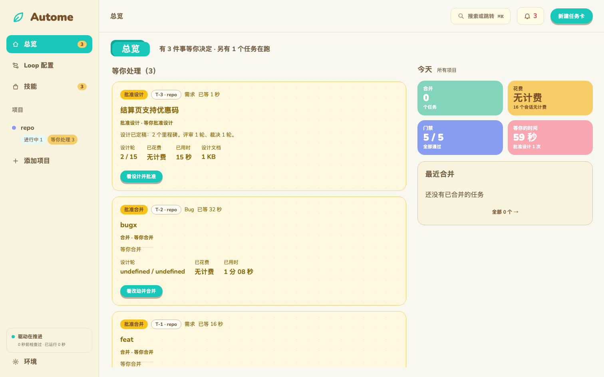
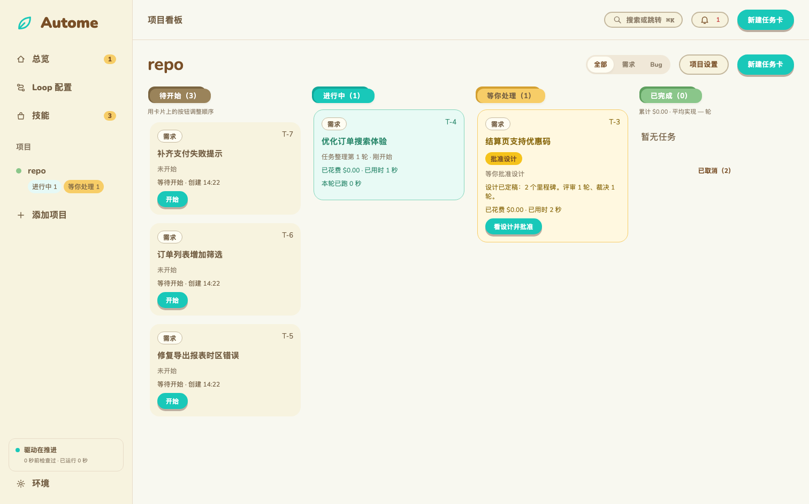
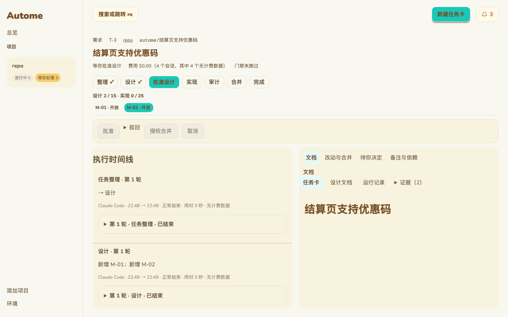

# Autome 2.0

A macOS desktop app that turns a one-line request into a merged branch.

You point it at a Git repository and type what you want. It runs Claude Code
and Codex through a Loop of six roles — design, review, adjudicate, implement,
audit, retro — in a dedicated worktree, and stops for you exactly twice: once
to approve the design, once to press merge.

## What it looks like

The web dashboard screenshots can be regenerated from isolated e2e fixtures
with `apps/web/scripts/screenshots.ts`. After building the core and web app, run
`npm run screenshots --prefix apps/web`. The script uses invented tasks and a
temporary ledger, and writes three 1512×944 images to `docs/images/`.

**The dashboard** — everything waiting on you, across every project, above
everything that is running. Nothing else competes for the space.



**A project** — tasks grouped by their current stage, with queue order and
dependencies available from the board.



**A task** — which node it sits at, the milestones it has closed, what the
current session is doing right now, and what it has produced. The stopping
panel says whether it needs you, and says so in the same place every time.



## The shape of it

```
Electron (UI only)  ──framed JSON-RPC over stdio──  automed (Rust, all state)
                                                          │
                                              ┌───────────┼───────────┐
                                           git/worktree  iTerm2   .autome/ · docs/
                                                          │
                                                   claude / codex
```

Three properties the design turns on:

- **The core owns every node transition.** An agent writes its result into the
  design document and exits; the scheduler reads the document and decides what
  runs next. That is what makes pause, the parallel limit, role toggles, round
  budgets and the two stopping points enforceable by the core rather than by
  the cooperation of a prompt.
- **Task progress lives in the repository**, in the design document's status
  block. It travels with the branch and survives a machine change. SQLite holds
  the registry, the index, the session ledger and your decisions.
- **Generation and evaluation never share a model.** Review must differ from
  design, audit from implementation, and retro from implementation. A
  configuration that violates this cannot be saved.

Sessions run in the background, each in a process group of its own; the task
panel and `autome logs -f` follow their logs live. Autome never pushes,
never opens a pull request, and never merges without you pressing the button.

## The Loop

```
intake → design → review ⇄ adjudicate ──▶ [approve design] ──▶ implement ⇄ audit
                                                                      │
                          cleanup ◀── merge ◀── [press merge] ◀── rebase ◀── retro
```

| Role | Reads | Writes | Moves the loop by |
|---|---|---|---|
| intake (system) | the request, attachments, `AGENTS.md`, `.autome/rules/` | `<slug>-task.md`, the design document's skeleton | — |
| design | task file, last review and adjudication | the design document and its milestone table | — |
| review | task file, design document — not past rulings | `<slug>-review.md`, six kinds of issue only | — |
| adjudicate | design, review, every past ruling | appends `<slug>-adjudication.md`, revises the design | `design-round` +1; `设计中 → 实现中` is the signal to stop for approval |
| implement | task file, design, last audit | code, `evidence/M-xx-r<k>-impl.md` | one open milestone to `待审` |
| audit | task file, design — not the implementation's reasoning | `<slug>-audit.md`, `evidence/M-xx-r<k>-audit.md` | `已完成`, back to `开放`, or a verification gap |
| retro | the measured run, all evidence | `lessons.md` | — |

Each role is a CLI, a model and an effort, set globally and overridable per
project on the routing screen, and has its own switch: a switched-off review,
adjudication, audit or retro is skipped. Intake, rebase, merge and cleanup are
system steps and cannot be switched off.

A project is either one repository or a **workspace**: a directory holding
several independent repositories, one of which keeps the documents. A
workspace task gets a worktree in each repository it touches and is merged
repository by repository.

### Host gate, retries and cooldowns

Gate commands can print a block delimited by `autome-gate-digest begin <step>` and `autome-gate-digest end` on separate lines. The core collects closed blocks from the last 256 KiB of the log, stores up to 16 KiB in `gate.result.digest`, and forwards them to the repair session separately from the log tail. Truncation names the complete log. The Web reporter lists failed tests with assertion locations, unexecuted tests, and runner errors, distinguishing global timeout, browser budget, setup failure and interruption. It preserves the unabridged report at `$AUTOME_GATE_LOG.playwright.json` (also copied to `.autome/output/playwright-gate/report.json`) and places its absolute path first in the digest. Requirement repair briefs link the failed gate and its log.

**Review scope recovery.** Audit, retrospective and Bug review sessions may still only change their task documents. On the first crossing, the core saves a binary patch under the main checkout's `.autome/output/scope/<task>/<session>.patch` (one per repository in a workspace), restores only the out-of-scope paths to the session baseline and commits the restoration, keeping document edits. `session.scope_restored` appears in `autome run`; `autome status` shows the latest attempt and whether its patches remain pending. The next implementation/fix session decides whether to adopt the patch; the core never applies it automatically. A final audit or retrospective can trigger an extra implementation → audit cycle; Bug review returns to fixing within its fix budget. A detached retrospective leaves the patch pending for manual handling or a later rerun.

The second consecutive crossing by the same role stops with the existing protocol-failure instructions plus “上一次已自动还原”. An intervening implementation/fix session does not reset the streak; a clean session of that same role does. Restoration failure also stops with the existing manual recovery instructions and `session.scope_restore_failed`. Save useful changes, restore only offending paths to the recorded baseline and commit, then rerun; do not reset the whole branch. Durable intent is recorded before restoration, so restart can resume interrupted work.

Things the core does on its own, none of which needs a prompt to
cooperate. Configure commands and retry policy in the project's `.autome/config.toml`:

```toml
[loop]
session_minutes = 120     # the default, at least 5; a session running longer is stopped and retried like a crash

[gate]
command = "make check"     # run with sh -c in the task's worktree
concurrency = 1            # optional heavy-lane project limit, capped globally
quick_concurrency = 1      # light lane; recommend 1–2 according to CPU capacity
run = "each_round"          # the default; "before_merge" runs the full gate only once, before the merge
quick = "make lint"         # optional; only active with before_merge
quick_timeout_minutes = 5  # optional quick timeout (positive minutes); FixGate uses timeout_minutes
timeout_minutes = 30       # the default; a gate that runs longer has failed
same_failure_limit = 3     # the default, 1–10: consecutive identical failures stop the task
reuse_for_main_check = true # the default; false always runs the post-merge gate

[merge]
auto = false                       # default; true merges after the gate without another approval
after = "sh scripts/install-cli.sh" # optional; sh -c in the main checkout
after_timeout_minutes = 10          # optional; the default

[budget]
per_task_usd = 20          # optional per-task USD limit; warns without stopping the task

[retry]
attempts = 2               # the default; 0 restores "a crash fails the task"
backoff_seconds = 60       # doubles each time: 1, 2, 4 minutes

[setup]
command = "npm ci --prefix apps/web"
watch = ["apps/web/package-lock.json"]
timeout_minutes = 30       # optional; preparation timeout

[bug]
fix_rounds = 3            # the default; an integer from 1–20
```

- **Host job queues.** Host jobs use two independent FIFO lanes across projects
  in one ledger. Full gates (`full`) and preparation commands use the heavy lane,
  controlled by `[gate] concurrency`. Quick checks (`quick`) and reproduction
  checks (`repro`) use the light lane, controlled by `[gate] quick_concurrency`.
  Both global limits default to 1 and accept integers 1–10; project overrides
  are capped by the global value. Set `quick_concurrency` to 1–2 according to
  available CPU capacity. Either concurrency key alone does not enable a gate.
  Admission counts only jobs and waiters in the same lane, with no node priority.
  Separate homes/ledgers are independent. Waiting consumes no rounds, failure
  counts or crash retries; timeout starts when the job actually starts.
  `task.get` and `dashboard.get` expose `gate_queue_lane` (`heavy`/`light`) and
  the live one-based `gate_queue_position`, both null when not queued.
  `autome status`/`run` distinguish “排队等完整门禁” from “排队等快检或复现检查”.
  `gate.queued` records the lane and enqueue position; ledger events restore both
  queues after restart. Legacy events and jobs without a recorded kind are heavy.
  Changing configuration while waiting moves a job to the new lane's tail;
  running jobs retain their launch kind. Preparation cannot transfer its heavy
  slot to a light check. This does not limit commands inside agent sessions.
- **Merge queue.** The regular Rebase step remains; when MergeGate leaves the
  host queue, it rebases again if the default branch has advanced. A cached gate
  result is reused only when the branch is also up to date. Authorized tasks
  take a project merge lock in FIFO order, before preparation, host admission
  and dequeue rebase, and keep it through the gate and merge. MainCheck, Cleanup
  and `[merge] after` are outside this section. Other tasks in the project wait
  to start MergeGate or execute Merging; lock waiters keep their queue order but
  do not block the host queue or consume a host job slot. This does not change
  `[gate] concurrency`, even when it is greater than one.
  Use `autome merge cart` before the stopping point to authorize the eventual
  merge; design approval and Bug information checkpoints still require attention.
  Authorization survives conflicts, failed gates, stops and retries. Use
  `autome merge cart --cancel` to revoke it, including for a task covered by
  project auto-merge. Revocation is refused once Merging has begun. A dequeue
  conflict releases the lock and returns to implementation (Bug: the fix round),
  retaining authorization; after repair the task queues again at the tail.
  Unapproved tasks stop at AwaitMerge without holding the lock. If main advances,
  `status`, `ls` and `task.get` show the stale result and number of commits behind;
  pressing merge then rebases and reruns the gate. `autome run` reports dequeue
  rebase and direct authorized merge. Queue order, authorization and lock
  ownership recover from the ledger after restart. The lock covers Autome merges
  in this project; external main commits can still trigger the behind/rebase retry.
  Project `[merge] auto = true` saves the manual merge approval, but lets passing
  changes enter main without a final human review. It defaults to false and
  coexists with `after`. Without `[gate]`, it warns rather than rejects the config:
  feature tasks merge after rebase without a gate; Bug tasks still run their
  reproduction command. Explicit user revocation overrides the project switch.
- **The gate.** With `[gate]` set and the default `run = "each_round"`, Autome
  runs the command itself after every
  implementation round, on the commit that round produced, and only an exit
  code of 0 lets the round reach audit. A failure goes straight back to
  implementation with the command and the log's tail in the prompt. After
  `same_failure_limit` consecutive failures with the same fingerprint at the
  same `gate`, `merge_gate` or Bug Loop `fix_gate` node, it stops the task with
  the reason and latest log path. Fix the environment, then use `autome rerun
  <id> <node>` or `autome extend <id> 1` to retry; the streak starts over. It runs
  again on the rebased head before the merge stopping point (skipped when the
  head already passed and the branch is not behind), and once more on `main` after the merge — that last
  run cannot undo the merge, so a failure there raises an alert on the
  dashboard instead. By default (`reuse_for_main_check = true`), when the merge
  commit has the same tree as the commit that passed MergeGate, Autome reuses
  that result if the merged head and the actual gate command also match. It
  records `gate.reused` without creating a verification checkout or starting
  another gate; set the option to `false` to always run the post-merge check.
  The audit round's brief says what the host saw, so the
  auditor reads a verdict it did not have to take on trust.

  With `run = "before_merge"`, full gating drops from once per round to
  once per task, at MergeGate. Gate problems and regressions surface not until the merge
  is about to happen, when the host runs the full gate; a failure sends the task
  back for another implementation round before retrying MergeGate. In this mode,
  sessions do not run the full gate themselves: implementation, audit, fix and
  fix-review sessions run milestone acceptance or reproduction commands and
  tests directly related to the changes. Bug fix rounds run the repro command, plus `quick` when configured;
  Bug MergeGate still runs both the repro command and the project gate.
  The post-merge MainCheck described above remains unchanged.

- **Two-level gate.** With `run = "before_merge"` and `quick`, the host runs
  quick checks after each implementation round, and reproduction plus quick checks
  after each Bug fix round. The full gate still runs before merging; quick results
  never replace it. Put formatting, lint and type checks in quick, aim for under
  one minute, and leave tests to the full gate. Autome does not append quick to
  the full command: projects decide whether the full gate includes those checks.
  `each_round` ignores quick. Quick requires a project gate `command`; these
  options are not global settings. Scripts receive `AUTOME_GATE_KIND` as
  `quick`, `full` or `repro`. Quick and reproduction checks use the independent
  light lane and do not wait behind full gates.

- **Preparation.** Optional `[setup]` runs on the host with `sh -c` before
  sessions and gates, in the merge verification checkout, and in the main
  checkout after merging (even without a gate). Each checkout remembers the
  last successful command and watched file contents; unchanged inputs skip it.
  An empty watch list runs once per checkout, then again only if the command
  changes. A blank command disables setup. Workspace projects skip it with
  one event per task. Failures or timeouts fail the task before merging; after
  merging they raise a project alert and cleanup continues. Logs and markers
  live in `.autome/output/`; `autome run` prints preparation events.
  Prefer commands such as `npm ci` that preserve lock files: a command that
  changes tracked files in the main checkout leaves it dirty and can block
  the next merge.
- **After merge.** Optional `[merge] after` runs on the host in the main
  checkout after merging, after MainCheck passes (when configured), and after
  main-checkout preparation, before removing the task worktree and branch.
  Preparation failure still allows the hook to run. The command receives
  `AUTOME_TASK` and `AUTOME_MERGE_COMMIT` (this task's full merge commit SHA);
  the checkout may already include later merges. A blank command disables it.
  The default timeout is 10 minutes. A non-zero exit or timeout raises one
  `after_merge_failed` project alert; the task still finishes as Done and the
  merge is not rolled back. Failed or skipped MainCheck and workspace projects
  skip the hook with a `merge.after_skipped` event.
  Jobs run in the background and reconnect after a core restart. `autome run`
  prints the start and result, or the skip reason; logs live at
  `.autome/output/gates/<task>/after_merge-<sha12>.log`.
  Write only gitignored outputs (or outside the checkout): changing tracked
  files can block the next merge. Stopping a task kills its hook; resuming
  runs it again, so commands should tolerate repeated execution.
- **Bug fix rounds.** Each fix session counts toward the budget, including
  rework after a failed gate, a rejected review or a rebase conflict. Automatic
  transitions check the budget before opening the next fix round; when it is
  exhausted, the task stops. Use `autome extend <task> <n>` to add fix rounds.
  Manual `autome rerun <task> fix` counts as a round and checks the same budget
  before starting a session. Both `fix_gate` and `merge_gate` run the reproduction command; when
  `[gate]` is configured, they run `( reproduction command ) && ( gate command )`.
- **Retries.** A session that crashes — non-zero exit, process gone — is
  started again after a backoff instead of failing the task. A session that
  wrote nonsense is not retried; that is a protocol problem, not bad luck.
- **Rate limits.** A crash whose output says 429, rate limit, usage limit or
  overloaded puts that CLI in a cooldown (10 minutes, doubling while it keeps
  happening, an hour at most, or until the reset time the CLI printed) and
  does not count as an attempt. While Claude Code cools down, its roles move
  to Codex when that still keeps generation and evaluation on different
  models, and wait otherwise.

Decisions you take on Backlog items and disputes are handed to the next
session that runs, and stay yours until that session finishes cleanly: if it
crashes, the next one carries them again.

## The command line

`autome` drives the same Loop from a terminal. It is not a client of the
desktop app — it links the core and opens the same ledger, so a task started
in one shows up in the other, and either can approve or merge it.

```sh
sh scripts/install-cli.sh               # in a checkout: build, install to ~/.local/bin
sh scripts/install-cli.sh --from dist/autome-0.1.0-aarch64-apple-darwin.tar.gz
curl -fsSL https://raw.githubusercontent.com/LinkedDestiny/autome/main/scripts/install-cli.sh | sh
                                        # elsewhere: the latest release (AUTOME_VERSION to pin)
cargo install --path crates/autome-cli  # or plainly, with Rust
```

`PREFIX` picks the directory. The installer checks the tarball's `.sha256`,
refuses an unverified download, and finishes with `autome doctor`.

### The panel

After installation, run `autome web` to start the panel and open your browser.
Node.js >= 22.22 is required (`brew install node`). Without it the installer
installs only the CLI; install Node and rerun the installer to add the panel.
The panel lives at `$(dirname "$PREFIX")/lib/autome/web`, beside the CLI prefix.
The release tarball also runs directly: keep `web/` beside `autome`.

- `autome web start`: start without opening a browser; repeated runs reuse it.
- `autome web status` (or `--json`): URL, process, kernel build, running gates and registered drivers (PID, command and latest tick). Older kernels fall back to lock-contention estimates.
- `autome web stop`: stop; refuses active gates unless `--force` is supplied.
- `autome web service install|uninstall`: manage optional macOS login startup.

The default port is 7420, with automatic fallback if occupied. An explicit
`--port` must be available. Runtime files and logs live in `$AUTOME_HOME/web`.

### Upgrading, and which build may drive the ledger

`autome --version` and `automed --version` include a build ID in parentheses:
`0004213-20261113T042058Z-7715d8ed0a1b` (ancestor count, commit time, short SHA).
Only the ancestor count orders commits; time is informational. Builds without
usable Git history, including shallow clones, report `unknown-<version>-<UTC time>`.
The CLI and its embedded kernel share one ID. Unknown builds cannot supersede
a known Git build; different unknown IDs and equal counts with different SHAs
are refused conservatively. Counts order descendants, not unrelated branches.

The ledger records the latest kernel to advance it. An older kernel can read
but cannot tick or write; it does not fail tasks or freeze their protocol.
The dashboard shows the reason and disables writes. Persistent `autome run`
stays alive and reports a refusal only when its reason changes; `--once` and
`--until-idle` exit with status 1. The diagnostic is:

> 这个内核（<标识>）比推进过账本的内核（<标识>）旧，已停止推进；请重新安装或设置 AUTOMED_BIN

For a deliberate rollback, `AUTOME_ALLOW_OLDER_KERNEL=1 autome run --once`
adopts the current kernel and records a `kernel.adopted` event. Only the literal
`1` works, once per process. A newer kernel can raise the mark again; an already
adopted old process then stops advancing. This does not bypass schema checks.

The dashboard uses `autome core`, the stdio kernel in the installed CLI file.
Resolution order: `AUTOMED_BIN`, `AUTOME_BUNDLED_CORE` (the CLI that launched the panel), the first `autome` on PATH,
`~/.local/bin/autome`, then a cargo build. `autome web` supplies its own path for custom PREFIX installs. Startup logs show the path and
build ID, explicitly identifying cargo builds.

For the first upgrade to schema v8, after merging:

1. Quit every old desktop app and dashboard, stop manually launched `autome run`,
   and unload the persistent driver with `launchctl bootout gui/$(id -u)/com.autome.loop`.
   Check `pgrep -fl 'autome|automed'` and continue only when no old kernel remains.
   Killing a KeepAlive process alone would let launchd restart the old executable.
2. Run `sh scripts/install-cli.sh`. Its final `doctor` opens and migrates the ledger.
3. Reload the driver with `launchctl bootstrap gui/$(id -u) ~/Library/LaunchAgents/com.autome.loop.plist`.
4. Repackage the desktop app before launching it, and restart the dashboard.

Migration rejects new connections from pre-v8 kernels, but cannot revoke old
connections that are already open: stopping all old processes must come first.
The Loop pauses during these steps without losing tasks. Do not start old apps
after migration. For later compatible reinstalls, use
`launchctl kickstart -k gui/$(id -u)/com.autome.loop` to replace the running driver,
and restart the dashboard kernel or dashboard.

Never test a worktree build against the real ledger or install location. Set
both `PREFIX` and `AUTOME_HOME` to temporary directories for installation tests.

### Using the CLI

```sh
autome doctor                            # Git, Claude Code, Codex, logins; where state lives
autome project add ~/code/shop --skip-onboarding
cd ~/code/shop
autome task new "购物车加一个结算按钮"    # -p picks the project when not inside it
autome run                               # drives the Loop; prints what happens
autome status                            # what waits on you, what runs, alerts
autome approve cart                      # a task by id or slug prefix
autome merge cart
autome merge cart --cancel  # revoke advance approval before merging starts
```

`autome run` is what moves things. The desktop app moves them too while it is
open; the two take turns through a lock beside the database, so running both
never starts a session twice. `autome run --until-idle` returns when nothing
is left that does not need a person, which is what scripts want. Ctrl-C stops
driving and leaves running sessions alone; the next `run`, or the app, picks
up their results.

Every command takes `--json`. Exit status is 0 on success, 1 when the core
refused or something failed, 2 for a mistake on the command line.
`autome rpc <method> '<json>'` reaches any JSON-RPC method the desktop uses.
`autome help` lists the rest: reject with feedback, pause, resume, stop,
cancel, turn a not-a-bug task into a feature, rerun from a node, extend the budget, decide Backlog items and
disputes, follow a session's log, dismiss alerts.

Use `--kind bug` for a Bug Loop task; the default kind is `feature`. The Bug
Loop goes through locate → reproduce → fix → fix gate → review → rebase →
merge gate → merge, and requires the audit role to be enabled.

Bug Loop 支持「修正回归测试」：修复轮或复核轮声明 `回归测试: 有缺陷`，
并在 `## 回归测试缺陷` 中写明用例、缺陷、证据、建议。内核最多退回定位轮 2 次，
该定位轮只能修测试和任务文档，不增加修复轮次。修正后的测试在隔离基线检出和当前
分支各跑一次：基线失败且当前分支通过才进入复核；当前分支仍失败回修复轮；基线
不失败按未复现处理。旧协议没有声明标记时保持原行为。

`--brief <file>` reads a UTF-8 task card; `--brief -` reads it from standard
input. With no request argument, the first `# ` heading supplies the title
(or the first non-empty line with leading whitespace and `#` removed if there
is no heading). Empty cards and cards larger than 65,536 bytes are rejected.
`--draft` saves the task without starting it or taking a slot; the text output
prints an `autome task start` hint. With `--json`, creation returns the raw
result containing `task`, `started` and `queue_position`; a draft has
`started: false` and `queue_position: null`.

```sh
autome task new --kind bug --brief - --draft --json < card.md
autome task start <task>
autome note <task> "A note for the next implementation/fix round" [--reopen]
autome reply <task> "Additional reproduction details"
autome extend <task> <n>
autome rerun <task> <node>
```

Declare dependencies when creating a task, or replace or clear them before implementation starts (Bug tasks must still be unstarted). Dependencies must be tasks in the same project; at most eight input IDs are accepted, and self-dependencies and cycles are rejected.

```sh
autome task new "Add checkout" --after T-41,T-47
autome after T-52 T-41,T-47
autome after T-52 --none
autome queue move T-52 --top
autome queue move T-52 --before T-44
autome queue move T-52 --after T-46
```

Queue moves accept queued tasks and drafts; a moved draft keeps its position when started. The scheduler skips blocked tasks without changing their positions until every dependency is Done. Cancelled or failed dependencies keep tasks queued until you change or clear the dependencies. Implementation resumes are not held by dependencies. Converting a task does not redirect dependencies to its replacement.

`autome ls` lists queued tasks in queue order with dependency annotations; `autome status` shows the queue, and `autome status <task>` shows its dependencies. JSON task objects expose `after` and `blocked_by`.

`autome task start` accepts only drafts. For Bug Loop tasks, `autome reply`
accepts non-empty information at `await_info` or `not_a_bug` and returns to
`locate`; other nodes reject it. For feature tasks it is equivalent to
`reject`, using the information as rejection feedback. `autome extend` adds
a positive integer number of rounds to an exhausted budget (fix rounds for
Bug Loop tasks). `autome rerun` restarts a failed or stopped task from a node;
Bug Loop tasks accept `locate`, `fix`, `fix_review` or `rebase`, plus the same
gate node after a repeated-failure trip.

## The protocol

The rules the roles run under live in [`protocol/`](protocol/) at the root of
this repository and are compiled into `automed`. There is no other copy on your
machine (ADR-0003).

```
protocol/
├── loop-protocol.md        # the rules all six roles share
├── session-protocol.md     # one session's boundaries and the status block format
├── prompts/                # one template per role, plus intake and onboarding
├── brief-map.toml          # which protocol sections each round's brief carries
├── evals/                  # behaviour cases a protocol change is held to
└── CHANGELOG.md            # what each version changed, and on what evidence
```

Each task freezes the whole protocol into `docs/<slug>/protocol/` before its
first session and records the version it ran under as `protocol_ref`, a tag
plus a content hash. Sessions read that copy, so installing a newer build
never changes the rules of a task already running. The version is the newest
`## protocol/vN` section of `protocol/CHANGELOG.md`; the protocol page shows
it, its changelog, and what tasks cost under each version.

Some regions of the protocol text are parsed by the core — the status block,
the milestone table, the Backlog and disputes, the role boundaries. They sit
between `<!-- kernel-contract: … -->` markers, and the core holds their
expected hashes; changing one means changing the parser too.

To change the protocol:

```sh
$EDITOR protocol/…              # and add a `## protocol/vN` section to protocol/CHANGELOG.md
cargo run -p automed -- protocol eval protocol/
cargo test -p automed --test prompt_rendering  # golden prompts; AUTOME_UPDATE_GOLDEN=1 to accept
sh scripts/ci-local.sh && sh scripts/package.sh
```

## Layout

- `protocol/` — the Loop protocol: rules, prompt templates, eval cases.
- `plugins/` — the `loop` plugin, the 1.x way of running the same kind of
  loop without the desktop app, packaged for Claude Code, Codex and Cursor.
- `crates/autome-domain` — pure types and transitions. No I/O, no async, no
  SQLite. The six roles, the configuration overlay and its validation, the
  design-document parser, the task state machine.
- `crates/automed` — everything that touches the outside world: SQLite, Git,
  the session launcher, the scheduler, the host gate, the protocol and its
  eval, the environment probe, the skill scan, and the JSON-RPC surface.
- `crates/autome-cli` — the `autome` command. Links `automed` and calls the
  same dispatcher the desktop's requests reach; no logic of its own beyond
  argument parsing and printing.
- `apps/desktop` — a thin Electron shell loading the Web panel, with native
  directory selection and notifications. The panel owns the core connection.
- `docs/development/` — the requirements and the technical design. These are
  the authority.
- `docs/plans/` — decision records and audits, dated. `docs/design/` — the
  interaction design and rendered copies of the documents.
- `docs/adr/` — the three decisions that shaped the repository.

## Where your state lives

One home, `~/.autome`, overridable with `AUTOME_HOME`:

```
~/.autome/
├── config.toml                 # global defaults; yours to edit
└── state/
    ├── automed.sqlite3         # registry, session ledger, your decisions, alerts
    └── automed.sqlite3.driver.lock   # held while one driver ticks the scheduler
```

Each project carries the rest in its own repository, committed so it follows
the repository between machines:

```
<repo>/
├── .autome/
│   ├── config.toml             # this project's overrides; absent fields inherit
│   ├── rules/                  # project rules every role must follow
│   ├── skill/run_session.sh    # the session wrapper; Autome-owned, refreshed
│   └── output/                 # session logs and gates/<task>/ gate logs (gitignored)
├── .worktree/<slug>/           # one checkout per running task (gitignored)
└── docs/<slug>/                # the task's documents, on its branch
```

Configuration changes take effect for the next session started; a running one
is not interrupted. `AUTOMED_DB_PATH` overrides the database alone, which is
how the test suites get one each.

The database used to default to `automed.sqlite3` in the working directory,
and the desktop app kept its own under Electron's `userData`. That made a
second installation the CLI could not see, and put the only ledger in a
directory Chromium owns — where, on the machine this was found on, a dead
prototype's database had been squatting on the path.

## Authority

`docs/development/requirements.md` and `docs/development/technical-design.md`
are the specification, and `docs/plans/2026-09-15-autome-2.0-project-task-ui-decisions.md`
records the decisions behind them. Where an older plan disagrees, the ADRs say
which one stands:

- ADR-0001 — 2.0 is an independent repository, not a migration of 1.x.
- ADR-0002 — the 2026-09-15 model supersedes the 09-13 greenfield plan.
- ADR-0003 — the protocol ships in the binary; there is no protocol repository.

## Building

```sh
cargo test                      # the domain, the core, and the end-to-end suite
cargo clippy --all-targets      # warnings are errors in CI
cd apps/desktop && npm test     # the shell, the gates and the renderer
```

All of the above at once, in the order and with the flags `.github/workflows/ci.yml`
uses:

```sh
sh scripts/ci-local.sh          # full gate; reuse only with a host-provided pass snapshot
sh scripts/ci-local.sh --package  # also builds the .app
sh scripts/ci-local.sh --all      # force every step (also CI_LOCAL_ALL=1)
sh scripts/ci-local.sh --plan     # print decisions and content keys, execute nothing
sh scripts/ci-local.sh --check-claims  # reject inputs missing from the declarations
```

Web tests use three explicit Vitest projects: parallel `unit`, `kernel` with four
workers, and serial `exclusive` for shared build/dev-server paths and timing checks.
A global setup builds once; nested test runs reuse that build. Assign new files in
`apps/web/test-groups.ts`; membership guards reject omissions and unsafe unit placement.

Rust tests use `--no-fail-fast` so all test targets run even after a failure.
The local gate continues through every step and ends with a bounded list of
failed Rust targets/cases and Web files/cases; omitted cases remain in the full log.
Steps declare commands and input prefixes in `scripts/ci/steps.sh`. Keys include
actual tracked and untracked non-ignored contents, toolchain versions (including
installed dependency trees), global inputs and unclaimed paths. A matching pass is reused only from an external
`AUTOME_GATE_PASSES` snapshot; absent, invalid or in-worktree snapshots cause
execution. `AUTOME_GATE_REPORT` receives incremental results when provided by
the host. Without host variables, every step runs and no report is written.
Preparation (including building both core binaries) runs when a following check
executes. Successful preparation refreshes keys for subsequent executed steps; earlier
results retain their original keys. After any preparation failure, keys remain
frozen for the rest of that run. Binary/target override variables are cleared to
keep tests on the freshly built `target/debug` binaries. Add new cross-directory test dependencies to the
step inputs even when another step already claims that directory.
Script-level regression tests run via `node --test scripts/test/*.test.mjs`.

The workflow runs on every push to GitHub. The local script is for the commits
in between — and it is how the Format and Clippy gates got caught 147 and 38
findings deep, back when there was no remote. To have every commit run it in
the background:

```sh
git config core.hooksPath .githooks
```

Results land in `.git/ci-local/last.log` and in a desktop notification.
`NO_CI=1 git commit …` skips it for one commit.

The end-to-end suite drives a whole task from a one-line request to a merge
commit against a real Git repository, with a stand-in for the model. Nothing
else is substituted: real worktrees, the real wrapper script, the real
exit-marker protocol, a real rebase and a real merge.

### Against the real CLIs

A stand-in cannot catch a flag that does not exist, or one that means
something other than what you assumed — and that is the class of bug that bit
this project hardest. `tests/real_cli.rs` runs the real binaries:

```sh
# Free, no account: asks each CLI for its own --help and checks every flag
# we pass appears in it.
cargo test --test real_cli every_adapter_flag

# Costs money, needs a logged-in account.
AUTOMED_REAL_CLI=1 cargo test --test real_cli -- --nocapture

# The whole loop, real models, to a real merge commit. ~40 minutes.
AUTOMED_REAL_CLI=1 AUTOMED_REAL_LOOP=1 \
  cargo test --test real_cli the_whole_loop -- --nocapture --test-threads=1
```

## Packaging

```sh
npm --prefix apps/web ci
npm --prefix apps/web run build
sh scripts/package.sh            # unsigned .app and .dmg in apps/desktop/dist, for local use
CSC_NAME="Developer ID Application: …" sh scripts/package.sh   # signed
```

To install locally, quit Autome, replace `/Applications/Autome.app` with
`apps/desktop/dist/mac-arm64/Autome.app`, and start it again. On start the
shell starts the bundled Web panel using Electron's Node runtime, or connects
to an existing `autome web` service. No system Node installation is needed.
The bundle carries `Resources/core/autome` and `Resources/web` outside asar.
Run `AUTOME_SMOKE_APP="$PWD/apps/desktop/dist/mac-arm64/Autome.app" npm --prefix apps/desktop run smoke`
to check startup, reuse, the older-kernel banner, and process cleanup in temporary homes.

Signing is opt-in rather than best-effort: an unsigned build that claims to be
signed is worse than one that says it is not. The hardened runtime is on, so
`build/entitlements.mac.plist` declares every capability the app uses —
including Electron JIT and framework loading. The shell does not request AppleEvents.

## Status

Feature-complete against the requirements document, and in daily use on
single repositories and workspaces. The loop was first verified end to end
against the real CLIs on 2026-09-16 (Claude Code 2.1.261, Codex 0.153.4): a
one-line request went through intake, design, review, adjudication, the
approval stop, implementation and an independent audit, to a merge commit on
`main` — six real sessions, the user pressing two buttons.

Not done: signing and notarisation have configuration but have never been run
(no Developer ID here), there is no application icon, and `automed` is spawned
without verifying its signature. Two drivers (the app and `autome run`) take
turns on a lock rather than one being refused, and the CLI is packaged for
Apple silicon only, because that is what CI builds on.

### 操作者备注

`autome note <任务> "内容"`（或 `--file <路径|->`）给下一需求实现轮、Bug 定位或修复轮捎话，不打断当前会话。成功收尾后标记送达，崩溃重试会再次呈现；状态页可查内容和收件轮。
没有后续实现轮时会补轮，再审计并过门禁。在合并卡点必须加 `--reopen`，预先合并授权保留；Bug 修复预算耗尽须先 `autome extend`。失败或停止时备注只记录，`rerun` 后送达。合并已经开始后只收下并警告，不再送达。备注与冻结设计冲突时须在证据说明，不能悄悄改范围。

The repository's `ci-quick.sh` runs a separate browser phase after related tests,
including when an earlier quick check fails. Changed specs select those files;
shared browser inputs select the whole suite. App/server changes use specs named
in the current milestone acceptance command, falling back to the whole suite.
Only a complete whole-suite pass can be reused by the merge gate.
`CI_E2E_BUDGET` defaults to 720 seconds and includes browser preparation. The
phase reserves 60 seconds before `AUTOME_GATE_DEADLINE`; on older kernels without
that variable it assumes a 600-second job starting when the script starts.
Less than 240 seconds remaining omits the browser run. Budget truncation without
failed cases records `not_run`; failed cases still reject the round. This budget
is independent of `CI_QUICK_BUDGET` (120 seconds). After upgrading the kernel,
configure this project's `quick_timeout_minutes = 20` to fit the whole suite.

The optional `[gate] quick_session = 'sh scripts/ci-quick.sh --since {round_start}'`
is the session command template: it requires `quick` and exactly one
`{round_start}` placeholder (blank templates are ignored). Without a template,
single-repository implementation/fix sessions receive the equivalent
`AUTOME_ROUND_START=<sha> sh -c '<quick>'`. Their brief, prompt, session event and
host check share the HEAD captured before the brief commit. Workspace sessions
retain the existing instruction. Every host gate exports `AUTOME_GATE_DEADLINE`
as its start time plus its effective timeout; Bug FixGate uses the full gate timeout.

The quick check's 120 seconds is an admission budget: an admitted step can finish
after it. The summary reports related-stage elapsed time and, on overrun, the last
step's start offset/duration and the number of remaining steps not run. Browser
preparation and execution are outside this budget. Web related candidates remain
one test file per step. Shared `automed/tests/` inputs select unit tests and
individual integration targets; the whole `end_to_end` target is explicitly
deferred to the merge gate, just as for edits outside existing test bodies.
